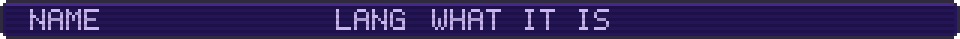
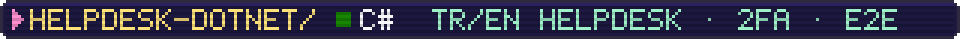
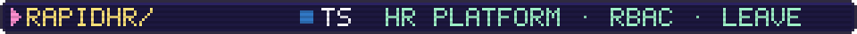
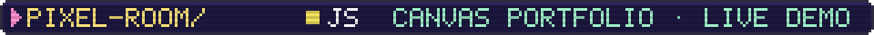
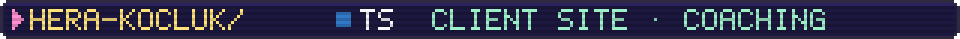
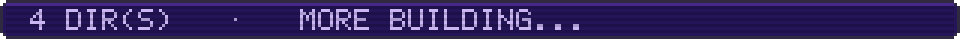
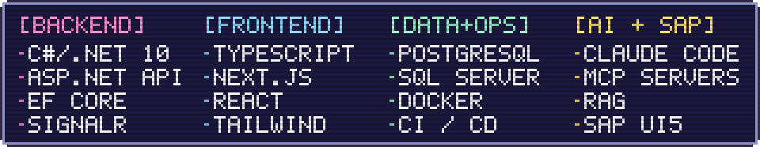

  

I build business apps with **C# / .NET** and **Next.js**, and I like making AI agents do real work: MCP servers, multi-agent workflows, RAG.

Right now I'm a software development intern and an Information Systems Engineering student at Kocaeli University, with an associate degree in Computer Programming from Marmara University. I also teach English, and I speak English, Turkish, Persian and Arabic.

The cat in the glasses is **Limoo**, my British Shorthair and the mascot of everything I ship.

  
  
  
  
  
  

**Open to** software roles, internships, collaborations and English students.

salehibourla@gmail.com · [LinkedIn](https://www.linkedin.com/in/bourla-salehi) · [Portfolio](https://bou-slh.github.io/Myportfolio/) · [Instagram](https://www.instagram.com/bou_slh/)

  

